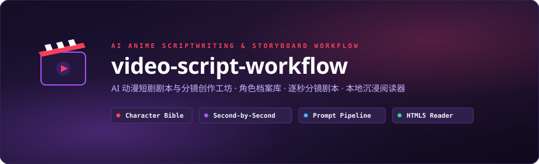

<div align="center">



<br/>

[](LICENSE)
[](agent.md)
[](#核心理念与四层递进结构)
[](#-沉浸式阅读器)

<br/>

**把模糊的创作想法打磨成直接喂给 AI 视频生成模型的完整剧本、分镜与提示词流水线。**

</div>

---

## 🎬 核心理念与四层递进结构

AI 视频制作最大的痛点在于「角色不一致」、「分镜缺乏运镜与节奏」、「提示词难以落地」。`video-script-workflow` 采用**结构化共创四层递进模型**：

```
讨论灵感 → ① 角色档案库 → ② 故事大纲 → ③ 详细分镜剧本 → ④ 生成提示词
           characters/     outline.md       script.md       P1-生成提示词.md
```

1. **① 角色档案库（`characters/`）**：跨故事持久化的人物长相、五官特写、身材比例与分场景衣着（校服、泳装、便服等），保障多镜头角色一致性。
2. **② 故事大纲（`stories/<故事>/outline.md`）**：一句话梗概 + 事件脉络 + 批次切分。
3. **③ 详细分镜剧本（`stories/<故事>/script.md`）**：精确到秒（如 `0:00 - 0:02`）的画面、运镜（Push/Pull/Pan）、台词、BGM、音效。
4. **④ 生成提示词（`stories/<故事>/P1-生成提示词.md`）**：中英双语可直接复制的 AI 视频生成 Prompt（支持 Kling / Runway / Sora / Luma / Haiper 等）。

---

## 📂 仓库结构

```tree
video-script-workflow/
├── agent.md                      # VidScript 核心导演 Agent 提示词与编剧规范
├── characters/                   # 跨故事持久化角色库
│   ├── 北村一诚/
│   ├── 日向步/
│   ├── 月花梨/
│   └── 雨宫太木/
├── stories/                      # 短剧剧目集合
│   └── 暑假·温泉合宿/
│       ├── outline.md            # 故事大纲
│       ├── script.md             # 逐秒分镜剧本
│       └── P1-生成提示词.md      # 分段生成提示词
├── 视频生成器/动漫流/            # 动漫渲染流样板与成片分镜测试
└── 阅读器/                       # 本地沉浸式分镜剧本 HTML5 阅读器
    ├── build.mjs                 # 阅读器编译脚本
    └── src/                      # 阅读器前端源文件
```

---

## 💻 沉浸式阅读器

本项目内置了专为分镜剧本打造的本地沉浸式阅读器，支持在浏览器中高保真呈现画面构图与台词节奏：

```bash
# 进入阅读器目录并构建/启动
cd 阅读器
node build.mjs
```

---

## 🤖 与 AI 协作创作

直接将 [`agent.md`](agent.md) 载入你的 AI 编程助手（Claude Code / Antigravity / Cursor / ChatGPT），即可开启视频编剧导演对话流！

---

## 📄 License

[MIT License](LICENSE) © 2026 Huanrui Zhang (TimeCraker)
